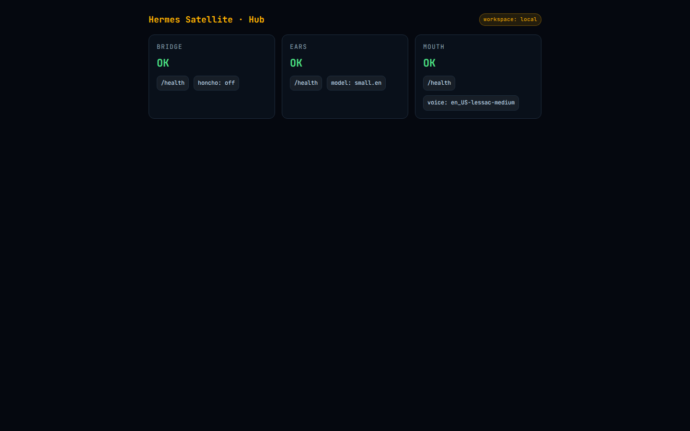
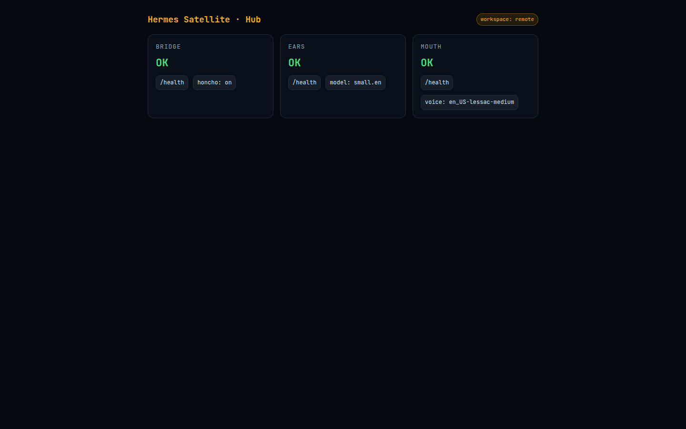
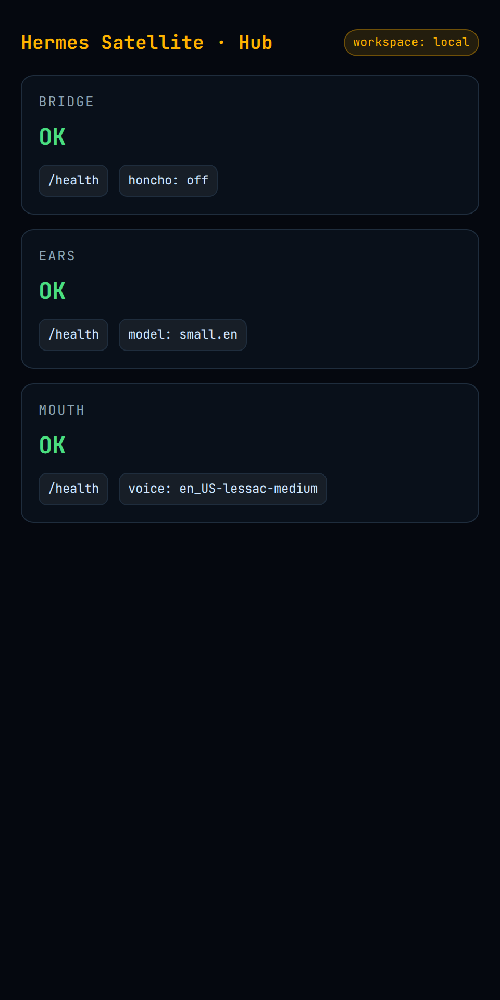

<div align="center">


# VoiceSat

**A Jarvis-style wake-word voice pipeline** — a hub and Raspberry Pi satellites that hear, think, and speak entirely on your own hardware.

<a href="https://github.com/OneByJorah/VoiceSat/stargazers"></a>
<a href="https://github.com/OneByJorah/VoiceSat/commits"></a>
<a href="LICENSE"></a>


</div>



## What This Is

Smart speakers stop working when the cloud does, and they hear everything you say. VoiceSat splits the job: a cheap Raspberry Pi satellite listens for a wake word and streams audio to a hub that runs STT, an LLM, and TTS locally and keeps conversation memory in Honcho. Add as many satellites as you want; they all share the same brain.

## Quick Start

```bash
git clone https://github.com/OneByJorah/VoiceSat.git
cd VoiceSat
cp .env.example .env       # set HERMES_API_URL, HONCHO_URL, HUB_BIND_IP

# On the hub
docker compose -f docker-compose.hub.yml up --build -d

# On each Raspberry Pi
docker compose -f docker-compose.satellite.yml up --build -d
```

### Raspberry Pi (bare metal)

```bash
pip install -r satellite/requirements.txt
python3 satellite/wake.py
```

See [SATELLITE_PI_DEPLOY.md](SATELLITE_PI_DEPLOY.md) for the full Pi deployment guide.

## Features

- **Wake-word detection** — "Hey Jarvis"-style activation with openWakeWord.
- **Local STT** — faster-whisper transcription, no cloud round-trip.
- **Local TTS** — Piper synthesis played back on the satellite.
- **Pluggable LLM** — any OpenAI-compatible endpoint via `HERMES_API_URL`.
- **Persistent memory** — long-term conversation memory with Honcho.
- **Multi-satellite** — deploy several Pi units against one hub, each with its own ID.
- **100% private** — audio and text stay on your network.
- **Pi-optimized** — runs on Raspberry Pi 4/5, with CPU-friendly int8 STT defaults.

## Architecture

```
Satellite (Pi)                         Hub (server)
┌─────────────────┐    Tailscale     ┌─────────────────────────────┐
│ Microphone      │                   │ Bridge (FastAPI :8000)      │
│   ↓             │   HTTP POST       │   ↓           ↓           ↓ │
│ Wake Word       │ ───────────────▶ │ Ears(:9000) LLM  Mouth(:9001)
│   ↓             │ ◀─────────────── │   (STT)   (API)   (TTS)    │
│ Speaker ◀───────│   audio/wav       │                             │
└─────────────────┘                   │ Dashboard (/dashboard/)     │
                                      └─────────────────────────────┘
```

- **Satellite** (`satellite/wake.py`) — captures audio, detects the wake word, POSTs WAV to the hub, and plays the reply.
- **Ears** — faster-whisper STT endpoint (`:9000`).
- **Mouth** — Piper TTS endpoint (`:9001`).
- **Bridge** — orchestrates STT → LLM → TTS, Honcho memory, and the dashboard. Published on host port **18000** so satellites can reach it while port 8000 stays local.

## Configuration

| Variable | Default | Description |
|----------|---------|-------------|
| `HERMES_API_URL` | — | LLM API endpoint (OpenAI-compatible) |
| `HERMES_API_KEY` | — | API key for the LLM |
| `HERMES_MODEL` | `hermes-3-llama-3.1-8b` | LLM model name |
| `HONCHO_URL` | — | Honcho server URL for memory |
| `HONCHO_API_KEY` | — | Honcho API key |
| `HONCHO_WORKSPACE_ID` | `hermes-satellite` | Honcho workspace |
| `WHISPER_MODEL` | `small.en` | faster-whisper model size |
| `WHISPER_DEVICE` | `cpu` | STT device (`cpu` / `cuda`) |
| `WHISPER_COMPUTE_TYPE` | `int8` | CTranslate2 compute type |
| `PIPER_VOICE` | `en_US-lessac-medium` | Piper TTS voice |
| `BRIDGE_URL` | — | Hub endpoint from the satellite (`http://<hub>:18000/satellite/utterance`) |
| `WAKE_MODEL` | `hey_jarvis` | openWakeWord model |
| `SATELLITE_ID` | `satellite-1` | Unique ID per satellite |
| `HUB_BIND_IP` | `127.0.0.1` | Hub service bind address |

> [!TIP]
> Set `HUB_BIND_IP` to your Tailscale IP to let satellites reach the hub without exposing it to the LAN.

## Hardware Requirements

| Component | Minimum | Recommended |
|-----------|---------|-------------|
| **Board** | Raspberry Pi 4 (2GB) | Raspberry Pi 5 (4GB+) |
| **RAM** | 2GB | 4GB+ |
| **Storage** | 16GB SD | 32GB+ SSD |
| **Audio** | USB mic + speaker | ReSpeaker HAT |
| **Network** | WiFi | Ethernet |

## Model Downloads

| Model | Size | Purpose |
|-------|------|---------|
| openWakeWord | ~10MB | Wake word detection |
| faster-whisper (base) | ~150MB | Speech-to-text |
| Piper (lessac) | ~50MB | Text-to-speech |
| LLM (via API) | — | Remote language model |

## Project Structure

```
VoiceSat/
├── satellite/
│   ├── wake.py                # Pi wake-word client
│   └── requirements.txt
├── hub/
│   ├── ears/                  # faster-whisper STT service (:9000)
│   ├── mouth/                 # Piper TTS service (:9001)
│   ├── bridge/                # FastAPI orchestration + dashboard (:8000)
│   └── dashboard/             # Web dashboard
├── docker-compose.hub.yml
├── docker-compose.satellite.yml
├── SATELLITE_PI_DEPLOY.md
├── docs/assets/               # Banner, screenshots
└── .env.example
```

## Use Cases

1. **Private voice assistant** — a local alternative to always-listening cloud speakers.
2. **Home automation front end** — trigger and query local services by voice.
3. **Multi-room voice** — one hub, several cheap Pi satellites.

## Tech Stack

Python 3.11+ · openWakeWord · faster-whisper · Piper · Honcho · FastAPI · Docker Compose · Raspberry Pi OS · Tailscale

## Screenshots

| View | |
|---|---|
|  |  |
|  | |

## Contributing

Contributions are welcome. See [CONTRIBUTING.md](CONTRIBUTING.md) and [CODE_OF_CONDUCT.md](CODE_OF_CONDUCT.md). [Open an issue](https://github.com/OneByJorah/VoiceSat/issues).

## License

MIT — see [LICENSE](LICENSE).

## Connect

- [jorahone.com](https://jorahone.com)
- [GitHub Org](https://github.com/OneByJorah)
- [info@jorahone.com](mailto:info@jorahone.com)
