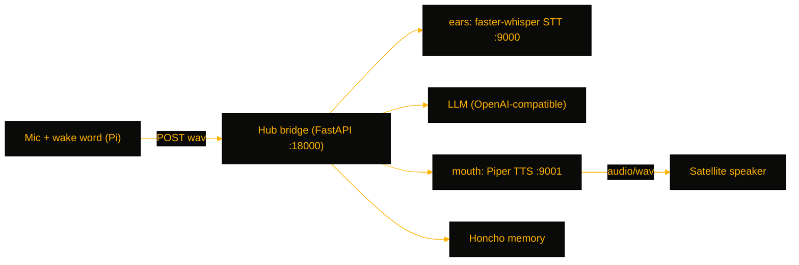

# VoiceSat

> Jarvis-style wake-word voice pipeline on your own hardware — Raspberry Pi satellites listen and speak, while one hub runs local STT, an LLM, and TTS, for anyone who wants a private multi-room voice assistant.

[](https://github.com/OneByJorah/VoiceSat)
[](https://github.com/OneByJorah/VoiceSat)
[](https://github.com/OneByJorah/VoiceSat/stargazers)
[](https://github.com/OneByJorah/VoiceSat/commits)
[](https://github.com/OneByJorah/VoiceSat/actions)

## What This Is

Cloud smart speakers stop working when the vendor's servers do, and they hear everything you say. VoiceSat splits the job in two: a cheap Raspberry Pi satellite listens for a wake word and streams audio over Tailscale/HTTP to a hub running faster-whisper STT, a pluggable LLM, and Piper TTS, with long-term conversation memory in Honcho. Add as many satellites as you want — they all share the same brain. Audio and text never leave your network.

## Quick Start

```bash
git clone https://github.com/OneByJorah/VoiceSat.git && cd VoiceSat
cp .env.example .env   # set HERMES_API_URL, HONCHO_URL, HUB_BIND_IP
docker compose -f docker-compose.hub.yml up --build -d        # on the hub
docker compose -f docker-compose.satellite.yml up --build -d  # on each Pi
```

See [SATELLITE_PI_DEPLOY.md](SATELLITE_PI_DEPLOY.md) for bare-metal Pi setup.

## Features

- "Hey Jarvis"-style wake-word activation with openWakeWord on the satellite
- faster-whisper transcription on the hub with CPU-friendly int8 defaults — no cloud round-trip
- Piper TTS synthesized on the hub and played back on the satellite
- Pluggable LLM against any OpenAI-compatible endpoint (`HERMES_API_URL`)
- Persistent cross-conversation memory via Honcho workspaces
- Multi-satellite: several Pis against one hub, each with its own `SATELLITE_ID`
- Bridge bound to a Tailscale IP so satellites reach the hub without LAN exposure

## Architecture



## Stack

Python 3.11+, openWakeWord, faster-whisper, Piper, Honcho, FastAPI, Docker Compose, Raspberry Pi OS, Tailscale.

## Contributing

Contributions are welcome — read [CONTRIBUTING.md](CONTRIBUTING.md), then [open an issue](https://github.com/OneByJorah/VoiceSat/issues).

## License

MIT — see LICENSE.
